# 固定资产借还管理系统

一个面向小团队的内部设备管理项目，用清晰、可追溯的流程管理公司固定资产的申请、审批、借出和归还。


> 从资产查询到申请、审批、实际交接、归还和逾期查询，让每一件设备的状态与历史记录保持一致。

## 项目简介

很多小团队仍使用聊天工具和手工表格管理设备，容易出现重复借出、审批结果不透明、逾期难以发现、归还记录缺失等问题。本项目把完整借还流程放进统一的网页系统：

- 员工可以查设备、提交申请，并查看自己的申请和借用记录。
- 管理员可以审批申请、确认实际借出、登记归还并发送站内通知。
- 同一件资产在服务端和数据库层保证不会重复预留或重复借出。
- 每次审批、交接和归还都会保留操作人、时间和状态历史。
- 管理员在线时可以实时收到提醒，离线后重新登录仍能看到持久化通知和待办。

## 核心业务流程

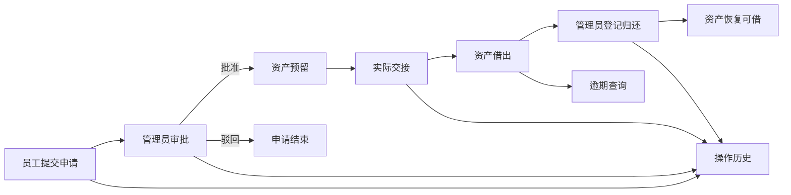

## 功能特性

| 模块 | 能力 |
| --- | --- |
| 账号与权限 | JWT 身份认证、管理员/员工角色、账号启用停用、管理员重置密码 |
| 资产台账 | 资产编号、名称、类别、序列号、位置、可借/预留/借出/维修/报废状态 |
| 借用申请 | 提交、取消、批准、驳回、确认实际借出、完整操作轨迹 |
| 借还管理 | 当前借用、逾期列表、历史记录、实际借还时间和经办信息 |
| 站内通知 | 持久化未读状态、Socket.IO 实时推送、管理员待办 |
| 手动通知 | 管理员选择全部启用账号或指定用户发送站内通知 |
| 数据保护 | 事务、悲观行锁、唯一索引、角色守卫、密码哈希和输入校验 |
| 响应式界面 | 桌面数据表格、手机卡片列表、键盘焦点和表单错误提示 |

## 界面预览

### 管理员工作台

<p align="center">
  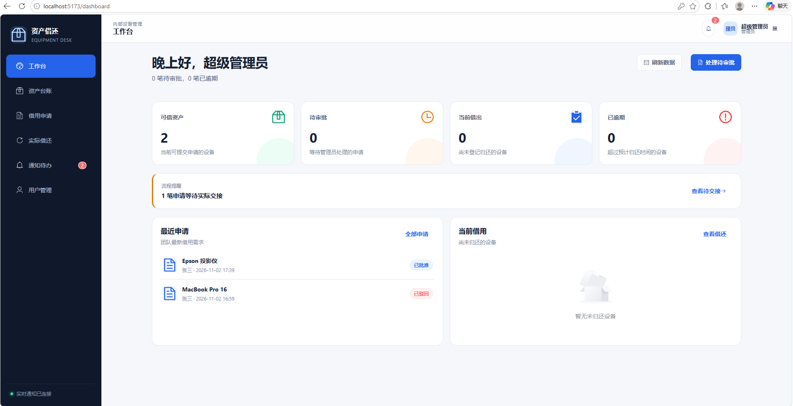
</p>

### 资产台账与借还管理

<p align="center">
  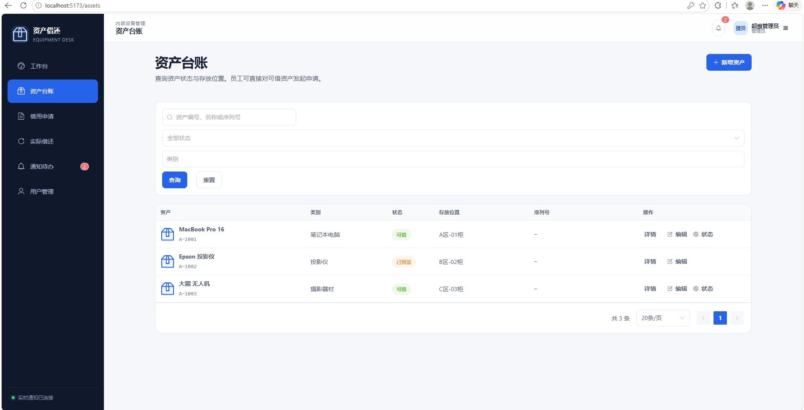
  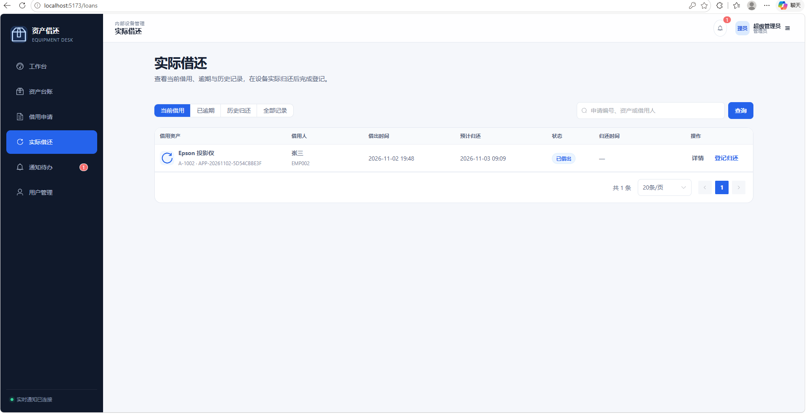
</p>

### 通知中心

<p align="center">
  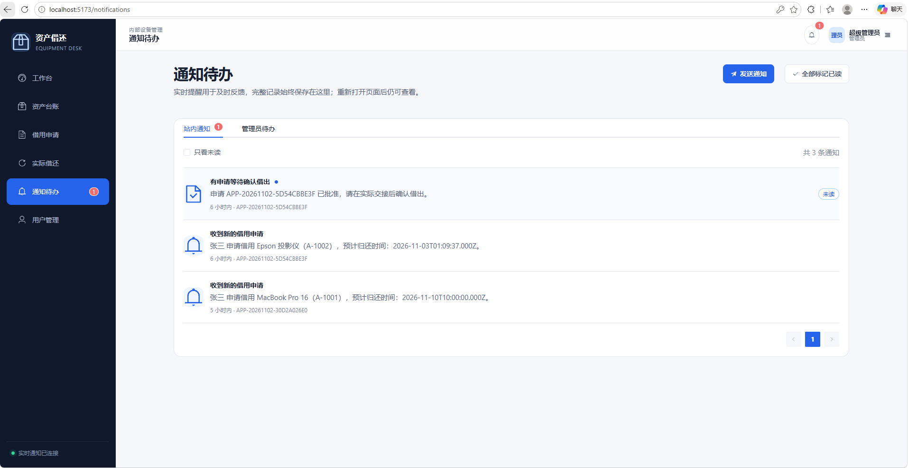
  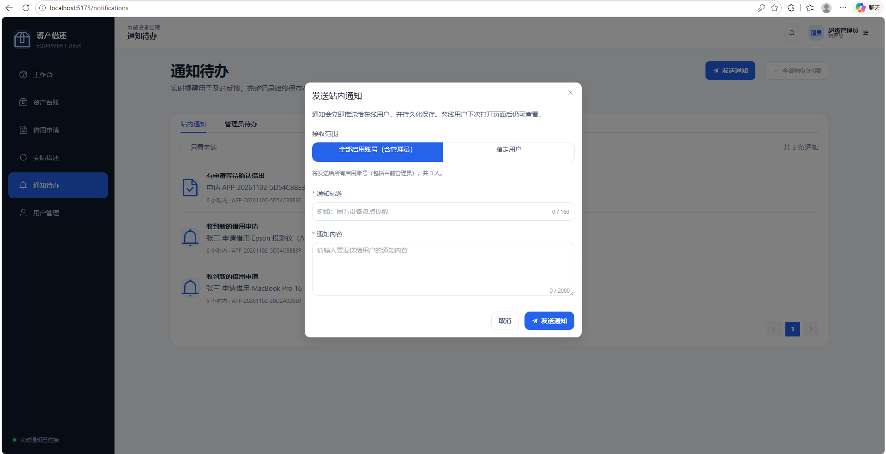
</p>

### 用户管理

<p align="center">
  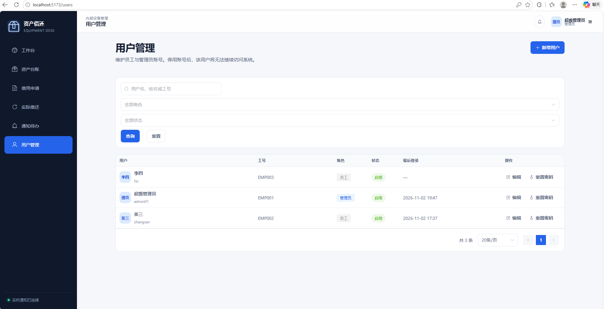
  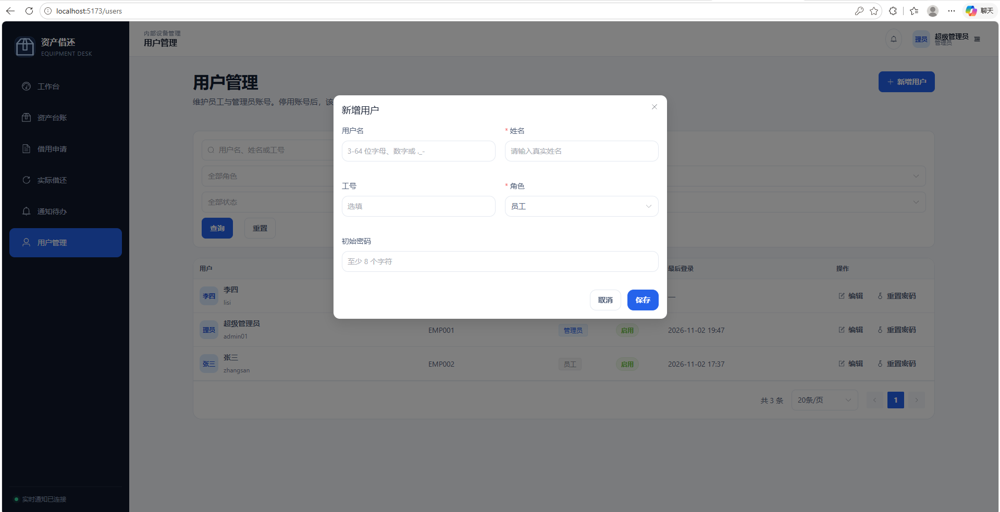
</p>

### 资产录入

<p align="center">
  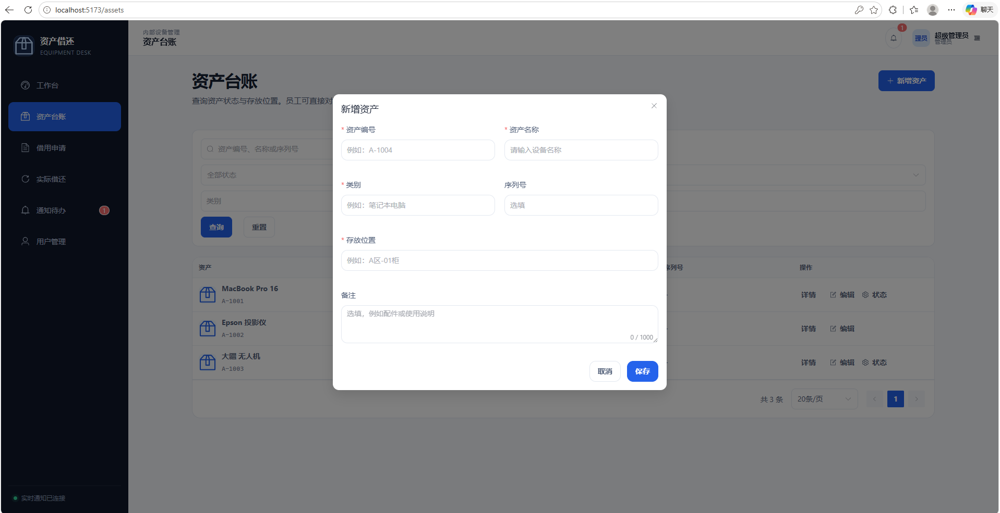
</p>

### 登录页

<p align="center">
  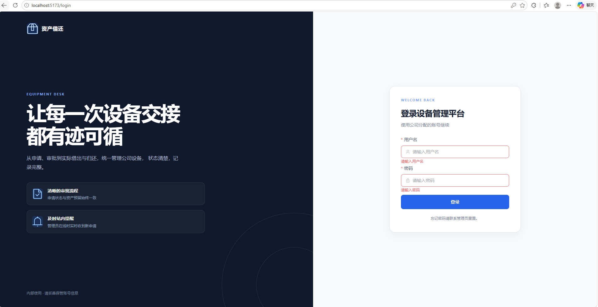
</p>

## 技术栈

| 层级 | 技术 |
| --- | --- |
| 前端 | Vue 3、TypeScript、Vite、Vue Router、Pinia、Element Plus |
| 后端 | NestJS、TypeORM、Passport JWT、Argon2id |
| 数据库 | MySQL 8.0、事务、悲观锁、生成列唯一索引 |
| 实时通信 | Socket.IO |
| 接口文档 | Swagger / OpenAPI |

## 技术架构

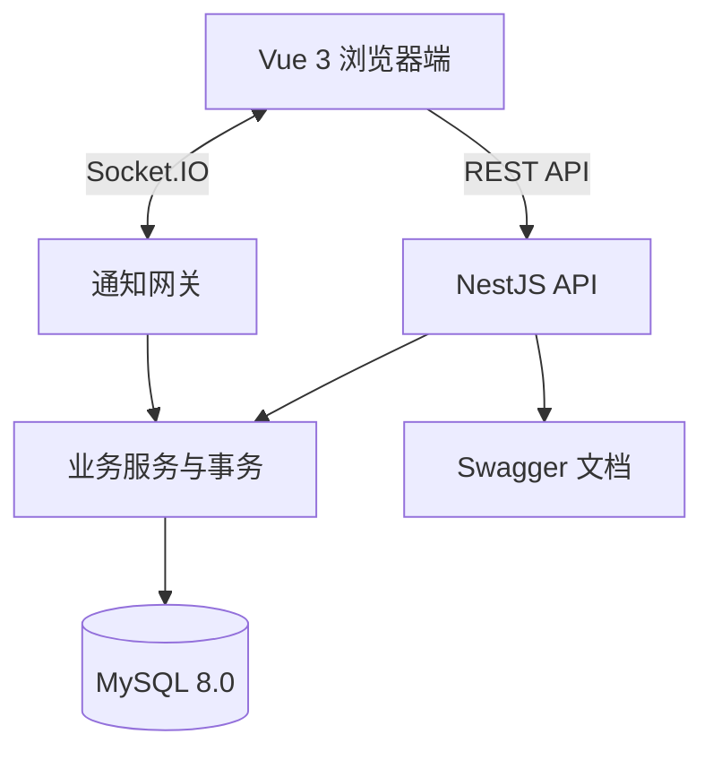

## 可靠性与安全设计

- 申请审批、借出和归还都使用数据库事务。
- 操作资产时固定使用行锁顺序，降低并发审批冲突。
- `active_asset_id` 生成列唯一索引从数据库层阻止同一资产重复预留。
- JWT 每次请求都会重新确认账号仍然存在且处于启用状态。
- 密码只保存 Argon2id 哈希，数据库凭据只存在于后端环境变量。
- 前端根据角色优化导航，但所有权限最终由后端验证。
- 通知先持久化再实时推送，断线重连后通过 REST 重新同步。

## 文档导航

- [后端接口文档](backend/docs/API.md)
- [后端设计说明](backend/docs/BACKEND_DESIGN.md)
- [前端设计说明](frontend/docs/FRONTEND_DESIGN.md)
- [数据库设计](database/DESIGN.md)
- [产品与业务上下文](AI_CONTEXT.md)

## 本地部署

下面按“数据库 → 后端 → 首次管理员 → 前端”的顺序完成本地部署。

## 1. 项目结构

```text
Desktop_program/
├─ backend/             NestJS 后端
├─ frontend/            Vue 3 前端
├─ database/
│  ├─ schema.sql        全新数据库建表脚本
│  ├─ migrations/       已有数据库升级脚本
│  └─ DESIGN.md         数据库设计
└─ README.md            本文档
```

## 2. 环境要求

- Node.js 22 或以上
- npm 10 或以上
- MySQL 8.0.16 或以上
- 支持现代浏览器的 Windows、macOS 或 Linux

检查版本：

```powershell
node --version
npm --version
mysql --version
```

## 3. 获取源码

使用 Git：

```powershell
git clone https://github.com/你的用户名/你的仓库名.git
cd 你的仓库名
```

也可以从 GitHub 下载 ZIP 并解压，然后进入项目根目录。

## 4. 初始化数据库

### 4.1 全新安装

使用 MySQL 管理员账号执行：

```powershell
mysql -u root -p
```

进入 MySQL 命令行后执行建表脚本。请替换为该项目在电脑上的实际路径：

```sql
SOURCE E:/path/to/Desktop_program/database/schema.sql;
```

也可以使用 Navicat、DBeaver 等工具打开并执行 `database/schema.sql`。

然后为应用创建独立数据库账号：

```sql
CREATE USER 'asset_loan_app'@'localhost' IDENTIFIED BY '替换为高强度数据库密码';
GRANT ALL PRIVILEGES ON asset_loan.* TO 'asset_loan_app'@'localhost';
FLUSH PRIVILEGES;
```

本地开发可以使用 `ALL PRIVILEGES`；生产环境建议只授予实际需要的权限，并使用独立迁移账号。

### 4.2 已有旧数据库

全新执行过最新版 `schema.sql` 的数据库不需要再运行迁移。

如果使用的是旧数据库，按文件名顺序执行 `database/migrations/` 中的迁移。例如：

```sql
SOURCE E:/path/to/Desktop_program/database/migrations/20261102_add_notification_sender.sql;
```

## 5. 配置后端

```powershell
cd backend
npm install
Copy-Item .env.example .env
notepad .env
```

`.env` 示例：

```env
NODE_ENV=development
PORT=3000
CORS_ORIGINS=http://localhost:5173

DB_HOST=127.0.0.1
DB_PORT=3306
DB_USERNAME=asset_loan_app
DB_PASSWORD=替换为数据库密码
DB_DATABASE=asset_loan
DB_LOGGING=false

JWT_SECRET=替换为至少32位随机字符串
JWT_EXPIRES_SECONDS=28800
```

生成随机 JWT 密钥：

```powershell
node -e "console.log(require('crypto').randomBytes(48).toString('hex'))"
```

注意：`DB_PASSWORD` 和 `JWT_SECRET` 不能保留示例值，否则后端会拒绝启动。`.env` 已被 `.gitignore` 排除，不能上传到 GitHub。

## 6. 创建第一个管理员

全新数据库没有默认用户，需要先插入一个管理员记录。使用 Navicat 或 MySQL 命令行执行：

```sql
USE asset_loan;

INSERT INTO users (
  username,
  employee_no,
  full_name,
  role,
  password_hash
) VALUES (
  'admin01',
  'EMP001',
  '超级管理员',
  'ADMIN',
  'RESET_REQUIRED'
);
```

这里的 `RESET_REQUIRED` 只是占位值，不能用于登录。插入完成后，在 `backend` 目录执行：

```bash
npm run auth:reset-password -- --username admin01
```

命令会提示安全输入新密码，并使用 Argon2id 哈希后更新该管理员账号。

如果数据库已经存在管理员账号，只需执行上面的密码重置命令，不要重复插入。

注意：

- `admin01` 和 `EMP001` 可以替换，但用户名和工号必须唯一。
- 密码不能保存为明文。
- 不要把真实管理员密码写入 SQL 文件、README 或 Git 仓库。

## 7. 启动后端

在 `backend` 目录运行：

```powershell
npm run start:dev
```

启动地址：

- API：`http://localhost:3000/api`
- Swagger：`http://localhost:3000/api/docs`
- 健康检查：`http://localhost:3000/api/health`

健康检查应返回数据库状态 `up`。

## 8. 启动前端

另开一个 PowerShell 窗口：

```powershell
cd frontend
npm install
npm run dev
```

浏览器访问：

`http://localhost:5173`

开发服务器会把 `/api` 和 `/socket.io` 代理到 `http://localhost:3000`。

如果修改了后端端口，需要同步修改 `frontend/vite.config.ts` 中的代理目标。

## 9. 登录和首次配置

1. 使用刚创建的管理员账号登录。
2. 进入“用户管理”创建员工账号。
3. 进入“资产台账”创建资产。
4. 让员工登录并提交借用申请。
5. 管理员在“借用申请”中批准并确认借出。
6. 设备归还后，管理员在“实际借还”中登记归还。

“通知待办”页面支持管理员选择全部启用账号或指定用户发送站内通知。

## 10. 构建验证

后端：

```powershell
cd backend
npm test
npm run build
```

前端：

```powershell
cd frontend
npm run build
```

前端生产文件生成在 `frontend/dist`，后端生产文件生成在 `backend/dist`。

## 11. 生产部署要点

- 前端 `dist` 作为静态文件，由 Nginx 等服务器提供。
- `/api` 和 `/socket.io` 反向代理到 NestJS，其中 `/socket.io` 必须支持 WebSocket Upgrade。
- 所有生产流量使用 HTTPS。
- MySQL 仅允许后端服务器访问，不开放公网端口。
- 使用进程管理器保持后端运行，并配置日志轮转。
- 定期备份数据库并实际验证恢复。
- `.env`、数据库备份、证书私钥不得提交到 Git。

## 12. 常见问题

### 后端提示数据库连接失败

检查 MySQL 服务、`.env` 中的主机、端口、用户名、密码和数据库名，并确认已执行 `schema.sql`。

### 前端请求返回 401

登录状态已失效或尚未登录。重新登录；若账号是数据库种子占位密码，先执行 `npm run auth:reset-password`。

### 实时通知未连接

确认后端在 `3000` 端口运行，前端通过 Vite 访问，并检查浏览器 Network → WS 中是否有 `/socket.io` 连接。

### 端口被占用

默认端口为后端 `3000`、前端 `5173`。关闭占用端口的程序，或同时修改 `.env`、Vite 配置和代理目标。

